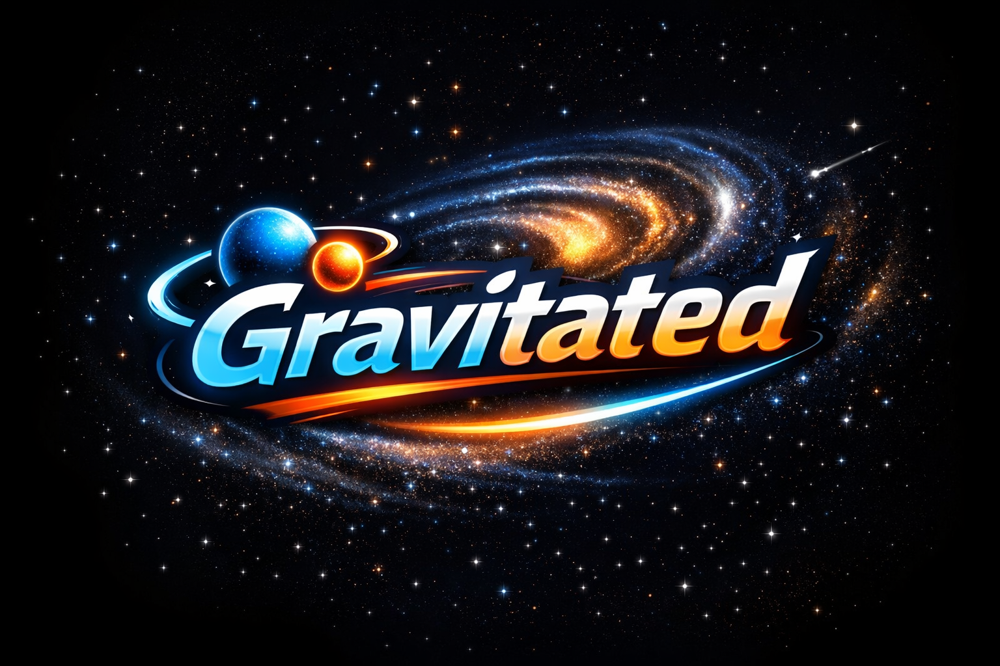

# Gravitated



An N-body gravity simulation that runs in the browser and as an Android app. The app is a single self-contained HTML page; the Android app is a thin `WebView` wrapper around the same page. Everything runs on your device and works offline.

## Get it

| Where | What |
|-------|------|
| **[jwkunz.github.io/Gravitated](https://jwkunz.github.io/Gravitated/)** | The web app, always the latest `main` (deployed by GitHub Pages) |
| **[Releases](https://github.com/jwkunz/Gravitated/releases)** | `gravitated-vX.Y.Z.html`, a single file you can save and open locally, and `gravitated-vX.Y.Z-debug.apk`, the Android app |

## Features

- N-body gravity simulation with up to 12 configurable bodies
- Inelastic body merging on collision
- Per-body angular momentum with visible rotating surface texture
- Dynamic mobile-friendly controls sheet
- Adaptive viewport with centroid tracking and auto-fit scaling
- Branded Android launcher icon

## Repository layout

```
VERSION                  the one place the project version lives
web/                     the simulation
  gravitated.html          the whole app: UI, rendering and physics (edit this)
  Gravitated_logo.png      logo
Android/                 Gradle project: a WebView app that bundles the web page
  app/src/main/java/       MainActivity hosting the WebView (WebViewAssetLoader)
  app/src/main/res/        launcher icons, theme and layout
.github/workflows/       ci.yml (checks, builds, releases) and pages.yml (site deploy)
```

The web app is edited in exactly one place, `web/gravitated.html`. Both the GitHub Pages site and the Android app are built from it, so a push to `main` updates the site, and the next APK build picks up the same code.

## How it fits together

There is no web build step. `web/gravitated.html` is copied:

- to the site as `index.html` by `pages.yml`,
- into the Android app's assets as `index.html` by the `copyWeb` Gradle task (`MainActivity` loads `https://appassets.androidplatform.net/assets/index.html`),
- onto each GitHub release as `gravitated-vX.Y.Z.html`.

## Building locally

**Web.** Open `web/gravitated.html` in a browser.

**Android.** Needs JDK 21 and the Android SDK (set `sdk.dir` in `Android/local.properties`, which is git-ignored).

```bash
cd Android
./gradlew :app:assembleDebug        # bundles the web page, then builds the APK
adb install -r app/build/outputs/apk/debug/app-debug.apk
```

The APK is a debug build; a Play Store upload would need a signed release build, which is not set up here.

## Continuous integration

- **`ci.yml`** runs on pushes to `main`, tags and pull requests: checks `VERSION` (and that it matches a release tag), checks the page is one self-contained file, and builds the debug APK.
- **On a `v*` tag** it also publishes a GitHub release containing the HTML file and the APK.
- **`pages.yml`** deploys the page to GitHub Pages on every push to `main`.

## Versioning and releasing

`VERSION` feeds the Android `versionName` and `versionCode` (`major*10000 + minor*100 + patch`) and must match the release tag.

```bash
echo 1.1.0 > VERSION
git commit -am "Release 1.1.0"
git tag v1.1.0 && git push origin main v1.1.0
```
